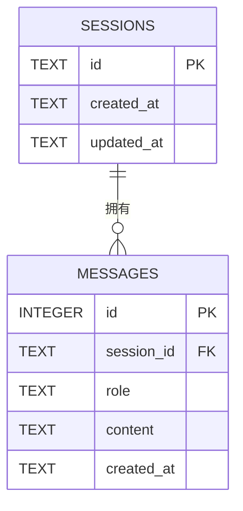

# Chatbot API

把命令行聊天机器人改造成 FastAPI 服务：多会话连续对话、流式输出、SQLite 持久化，外加一个内置网页界面和一个学习功能（英语单词讲解）。

## 功能

- 多会话连续对话：`session_id` 由调用方提供，同一 ID 带历史，不同 ID 互不串话
- 流式输出：`/chat/stream` 边生成边返回纯文本
- 会话管理：列出会话、查看消息记录、清空会话
- 会话与消息持久化到 SQLite（`chat.db`），服务重启后数据仍在
- 内置网页聊天界面，浏览器打开 http://127.0.0.1:8000 即可使用
- 学习功能：`/study/word` 讲解英语单词（词性、释义、搭配、例句）
- 配置集中在 `config.py`，用 `.env` 覆盖；API Key 用 `SecretStr` 保存，不会出现在日志和响应里
- 38 个离线单元测试，不联网、不需要真实 API Key

## 目录结构

    .
    ├── src/chatbot/
    │   ├── app/
    │   │   ├── main.py          # FastAPI 应用与路由，末尾挂载静态目录
    │   │   ├── schemas.py       # 请求 / 响应模型（含校验）
    │   │   ├── store.py         # 会话存储：SQLite 读写全部在这里
    │   │   ├── db.py            # SQLite 连接与建表语句
    │   │   ├── study.py         # 学习功能：单词讲解
    │   │   ├── deps.py          # 依赖注入：配置、存储、模型客户端
    │   │   └── static/
    │   │       └── index.html   # 纯 HTML 聊天页面（内联 CSS / JS）
    │   ├── config.py            # 全部可变配置
    │   ├── llm.py               # 大模型调用封装（流式 / 非流式）
    │   └── cli.py               # 命令行版（上一版作业，仍可运行）
    ├── tests/                   # 38 个离线测试
    ├── pyproject.toml
    ├── requirements.txt
    └── requirements-dev.txt

## 快速开始

    python -m venv .venv
    source .venv/bin/activate          # Windows: .venv\Scripts\activate
    pip install -r requirements-dev.txt
    cp .env.example .env               # Windows: copy .env.example .env
    # 编辑 .env，填入 CHATBOT_API_KEY

启动服务：

    uvicorn chatbot.app.main:app --reload

- 聊天页面：http://127.0.0.1:8000
- 交互式文档（可直接点着测）：http://127.0.0.1:8000/docs

命令行版仍在：`python -m chatbot.cli`

## 配置

所有可变参数都在 `config.py`，可用 `.env` 或环境变量覆盖（前缀 `CHATBOT_`）。`.env` 已写入 `.gitignore`。

| 变量 | 默认值 | 说明 |
| --- | --- | --- |
| `CHATBOT_API_KEY` | 空 | 接口密钥，`SecretStr` 保存，打印只显示 `**********` |
| `CHATBOT_BASE_URL` | `https://api.openai.com/v1` | OpenAI 兼容接口地址 |
| `CHATBOT_MODEL` | `gpt-4o-mini` | 模型名 |
| `CHATBOT_TEMPERATURE` | `0.7` | 0~2，越界抛 `ValidationError` |
| `CHATBOT_MAX_TOKENS` | `1024` | 单次回复上限 |
| `CHATBOT_SYSTEM_PROMPT` | 中文助手提示词 | 对话用的 system prompt |
| `CHATBOT_STUDY_SYSTEM_PROMPT` | 英语老师提示词 | 单词讲解用的 system prompt |
| `CHATBOT_HISTORY_LIMIT` | `20` | 每次请求最多携带多少条历史 |
| `CHATBOT_DB_PATH` | `chat.db` | SQLite 数据库文件路径；`:memory:` 表示内存库（测试用） |

## 网页界面

启动服务后直接访问 http://127.0.0.1:8000（不是 `/docs`，就是根路径），会打开聊天页面：

    uvicorn chatbot.app.main:app --reload

页面功能：

- 输入框发消息，回复通过 `/chat/stream` **逐字渲染**（不是等全部生成完才显示）
- 左侧列出所有会话，点击可切换；当前会话的历史消息自动加载
- 「＋ 新建会话」生成新的 `session_id`；「清空当前会话」调用 `DELETE /sessions/{id}`
- 刷新页面后仍停留在上次的会话（ID 存在 localStorage 里）

实现说明：单个 `index.html`，内联 CSS 与原生 JS，没有引入任何框架或 CDN。
前端只调用 HTTP 接口，不直接接触数据库，也不含任何密钥——key 只在服务端 `.env` 里。

## 数据库

会话与消息存在 SQLite 文件 `chat.db` 中（由 `CHATBOT_DB_PATH` 指定），服务启动时自动建表：

- 一个会话（`SESSIONS`）对应零到多条消息（`MESSAGES`）；`MESSAGES.session_id` 是指向 `SESSIONS.id` 的外键
- 外键带 `ON DELETE CASCADE`：删除会话时其消息一并删除，不会留下孤儿记录
- 连接时执行 `PRAGMA foreign_keys = ON`（SQLite 默认不检查外键），否则级联删除不会生效
- `MESSAGES.role` 有 `CHECK (role IN ('user','assistant'))` 约束，防止写入非法角色
- 索引 `(session_id, id)` 覆盖"按会话取消息并按顺序返回"的查询
- 建表语句见 `src/chatbot/app/db.py` 的 `SCHEMA` 常量，与上图字段一一对应

`chat.db` 属于运行时产物，已写入 `.gitignore`（`*.db`），不会提交到仓库。

## 接口

### POST /chat — 一问一答（非流式）

    curl -X POST http://127.0.0.1:8000/chat \
      -H "Content-Type: application/json" \
      -d '{"session_id": "u1", "message": "我叫小明，请记住"}'

    {"session_id": "u1", "reply": "好的，小明，我记住了。"}

同一 `session_id` 再来一次，会带上之前的对话：

    curl -X POST http://127.0.0.1:8000/chat \
      -H "Content-Type: application/json" \
      -d '{"session_id": "u1", "message": "我叫什么名字？"}'

    {"session_id": "u1", "reply": "你叫小明。"}

换个 `session_id`（比如 `u2`）问同样的问题，它答不出——会话之间互不影响。

### POST /chat/stream — 流式问答

请求体与 `/chat` 相同，响应是逐块返回的纯文本（`text/plain`）。`curl` 要加 `-N` 关闭缓冲，才能看到一段段输出：

    curl -N -X POST http://127.0.0.1:8000/chat/stream \
      -H "Content-Type: application/json" \
      -d '{"session_id": "u1", "message": "用三句话介绍杭州"}'

流结束后，完整回复同样会写入该会话的历史记录，可以用下面的接口查到。

### GET /sessions — 会话列表

    curl http://127.0.0.1:8000/sessions

    {"sessions": ["u1", "u2"]}

### GET /sessions/{session_id}/messages — 消息记录

    curl http://127.0.0.1:8000/sessions/u1/messages

    {"session_id": "u1",
     "messages": [
       {"role": "user", "content": "我叫小明，请记住"},
       {"role": "assistant", "content": "好的，小明，我记住了。"}
     ]}

按对话顺序返回，每条只有 `role`（`user` / `assistant`）和 `content` 两个字段，前端可以直接渲染成气泡。

### DELETE /sessions/{session_id} — 清空会话

    curl -X DELETE http://127.0.0.1:8000/sessions/u1

返回 `204 No Content`。清空后会话仍然存在，消息记录为空数组，可以继续用同一个 `session_id` 对话。

### POST /study/word — 学习功能：单词讲解

    curl -X POST http://127.0.0.1:8000/study/word \
      -H "Content-Type: application/json" \
      -d '{"word": "serendipity"}'

    {"word": "serendipity",
     "explanation": "名词：意外发现美好事物的运气……"}

讲解包含词性与释义、常见搭配、一个例句及翻译。这个接口**不接入对话会话**，不读写历史，也不会影响 `/chat` 的上下文。

### GET /health — 探活

    curl http://127.0.0.1:8000/health

    {"status": "ok"}

## 错误码

| 状态码 | 场景 |
| --- | --- |
| `404` | 查询或清空不存在的会话 |
| `422` | 消息为空 / 只有空白字符，或 `session_id` 为空 |
| `502` | 上游模型调用失败（网络、鉴权、限流等），响应里只给出异常类型，不含密钥 |

## 测试

    pytest

38 个用例，全部离线：API 测试用 `TestClient` 发请求，`tests/fake_model.py` 替换模型客户端；
数据库测试用 `tmp_path` 下的独立 `.db` 文件，不碰开发机的 `chat.db` 与 `.env`。

- `tests/test_db.py`：建表、历史顺序、会话隔离、清空、不存在的会话抛错、重开连接后数据仍在
- `tests/test_api_chat.py`：同会话连续对话、跨会话隔离、空消息被拒、模型异常回滚、单词讲解接口
- `tests/test_api_sessions.py`：会话列表、消息顺序、清空、404
- `tests/test_api_stream.py`：模型收到 `stream=True`、流式内容正确、完整回复写入历史
- `tests/test_web.py`：首页返回 index.html、静态挂载不影响接口、页面不含密钥
- `tests/test_config.py`、`tests/test_llm.py`：配置校验与模型调用参数（上一版作业）

## 设计说明

- **会话存储集中在一个模块**：`app/store.py` 是唯一读写会话的地方，路由只调用它的方法。以后换成 MySQL/PostgreSQL，只需要重写这个类，路由代码不用动。
- **依赖注入便于测试**：`app/deps.py` 提供 `get_store` / `get_client`，测试里用 `app.dependency_overrides` 整包替换成假实现，所以测试完全不联网。
- **流式结束才写历史**：`/chat/stream` 在生成器里边发边累加，正常结束才把完整回复写入会话；中途失败会撤销那条提问，保证 user / assistant 成对。
- **静态挂载放在路由之后**：`app.mount("/", StaticFiles(...))` 会匹配所有路径，必须写在所有接口之后，否则 `/chat` 等会被静态目录"吞掉"返回 404（`tests/test_web.py` 有此断言）。
- **数据库路径来自配置**：`get_store()` 用 `lru_cache` 懒加载，路径取 `CHATBOT_DB_PATH`，既不会在 import 时建库文件，也不会退化成内存库。

## 在 Windows PowerShell 里调用

`curl` 的引号在 PowerShell 里容易被吃掉，建议用原生命令：

    $body = @{ session_id = "u1"; message = "你好" } | ConvertTo-Json
    Invoke-RestMethod -Method Post -Uri http://127.0.0.1:8000/chat `
      -ContentType "application/json; charset=utf-8" -Body $body
